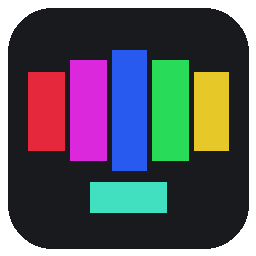

<p align="center"></p>

# PLAYERSLICE

Player de vídeo para **ecrãs LED fora de formato** — vários ledwalls com tamanhos e
formatos diferentes, alimentados pelas saídas de uma (ou mais) placas gráficas.
Na linha do Resolume Arena / Pixera / Millumin, mas focado numa coisa: pôr cada
vídeo no sítio certo de forma rápida, prática e estável.

Criado por **Daniel Nunes** — [github.com/NunesDanielPT](https://github.com/NunesDanielPT)

---

## Como funciona

```
 Clips (layers × colunas)  ──►  Composição (ex. 7680x2160)  ──►  Slices  ──►  Saídas da gráfica
                                  cada layer pode ter uma          recortam a        monitores / projetores /
                                  "Região" (a zona do ledwall)     composição ou     processadores LED
                                                                   uma layer só
```

* **Composição** — uma tela grande onde se arrumam todos os conteúdos.
* **Layers** — linhas da grelha de clips. Cada layer pode ter uma **região** na
  composição (ex. a zona do ledwall `CENTER T`, 720x648): os vídeos dessa layer
  encaixam lá automaticamente (esticar / caber / preencher / tamanho nativo).
* **Colunas** — clicar no cabeçalho de uma coluna dispara todas as layers ao mesmo tempo.
* **Ecrãs** — cada ecrã é uma saída: um monitor/saída física da gráfica, uma
  janela (para testar), ou desligado.
* **Slices** — cada slice recorta um retângulo da composição (**Entrada**) e
  coloca-o numa posição/tamanho/rotação do ecrã (**Saída**). A fonte pode ser a
  composição inteira ou **só uma layer** (dedicar layers a uma saída).

Fluxo típico: o cliente entrega cada vídeo no formato exato de cada ledwall →
crias uma slice por ledwall → **"Criar layer dedicada a esta slice"** → arrastas
os vídeos do Explorador para essa layer.

## Editor de Saídas e Slices

| Ação | Como |
|---|---|
| Mover | arrastar a slice (Shift = só um eixo) |
| Redimensionar | 8 pegas (Shift = manter proporção, Ctrl = a partir do centro) |
| Rodar | círculo turquesa por cima da slice (Shift = passos de 15°) |
| Snap a bordas e centros | automático (Alt desliga) |
| Afinar ao píxel | setas (Shift = 10 px) |
| Duplicar / Apagar | Ctrl+D / Del |
| Zoom / mover vista | roda do rato / botão do meio ou Espaço + arrastar |
| Desfazer / Refazer | Ctrl+Z / Ctrl+Y |

O fundo do editor mostra o vídeo real (composição na Entrada, saída na Saída) e o
**Test pattern** desenha xadrez, círculo e diagonais em cada slice, na cor da slice.

## Preview e Programa

* Clicar na **metade de cima** de um clip põe-no no **Programa** (no ar).
* Clicar na **metade de baixo** põe-no em **Preview** (não vai para as saídas).
* Clicar no **cabeçalho de uma coluna** põe a coluna inteira no ar.
* **Enter** (ou "Enviar para programa") passa o preview para o ar sem recomeçar o vídeo.
* Os monitores Preview e Programa têm o seletor **Ver**: composição inteira,
  um ecrã (exatamente como sai na saída, com todas as slices) ou só uma slice.
* No editor de Saídas e Slices o fundo pode mostrar o **Programa**, o **Preview**
  ou nada, com opacidade ajustável — para desenhar as slices por cima do vídeo.

## Efeitos, propriedades e layouts

* **Efeitos** (no clip, na layer ou na composição): Cor, Inverter, Tingir, Preto e
  branco, Limiar, Espelho, Pixelizar, Separação RGB, Vinheta, Strobe — arrastar do
  painel **Efeitos**.
* Painéis de propriedades **Composição · Layer · Coluna · Clip**.
* Layers e colunas com **cores**, menus completos e colunas **arrastáveis**.
* **Ctrl/Shift+clique** para selecionar vários clips; **Ctrl+C / Ctrl+V / Ctrl+X / Del**.
* Menu **Layout**: painéis, monitores extra de programa/preview, gravar/carregar layouts.

## OSC (Companion)

Definições → OSC. Endereços iguais aos do Resolume (layer 1 = a de baixo):
`/composition/columns/N/connect`, `/composition/layers/L/clips/C/connect`,
`/composition/layers/L/clips/C/select` (preview), `/composition/layers/L/clear`,
`/composition/disconnectall`, `/composition/layers/L/video/opacity`,
`/composition/video/opacity`, e ainda `/playerslice/outputs/toggle|on|off`,
`/playerslice/screens/N/output`, `/playerslice/preview/take|clear`.
Feedback: `/composition/layers/L/clips/C/connected 0/1`, `/playerslice/outputs/live 0/1`.

## Saídas: ligar e desligar

* Cada ecrã tem a opção **"No atalho"**. **F12** liga/desliga os ecrãs marcados
  (se nenhum estiver marcado, todos). **Ctrl+F12** liga todas, **Shift+F12** desliga todas.
* Botão **SAÍDAS LIGADAS / DESLIGADAS** na barra de estado e no Monitor de saídas.
* Nas Definições escolhes o que acontece ao desligar: **preto** (recomendado em
  espetáculo) ou **fechar a janela**.

## Definições

Idioma (Português / English) · Placa gráfica · Placa de rede · Placa de som ·
Atalhos de teclado (todos editáveis) · Atualizações · Sobre.

| Atalho (predefinido) | Ação |
|---|---|
| F12 / Ctrl+F12 / Shift+F12 | Ligar-desligar saídas marcadas / ligar todas / desligar todas |
| F1 … F9 | Disparar coluna 1 … 9 |
| Enter / Ctrl+Backspace | Enviar preview para programa / limpar preview |
| Shift+Esc | Parar todos os clips |
| Ctrl+T | Test pattern do ecrã selecionado |
| Ctrl+E | Editor de saídas e slices |
| Ctrl+S / Ctrl+Shift+S / Ctrl+O | Gravar / Gravar como / Abrir |
| Ctrl+Z / Ctrl+Y | Desfazer / Refazer |
| Ctrl+, | Definições |

## Atualizações

Ao abrir, a app consulta a última *release* deste repositório no GitHub. Se houver
uma versão nova aparece um aviso (nunca com saídas no ar); também há o botão
**Procurar atualizações** nas Definições. O instalador novo é descarregado,
instalado em silêncio e a app volta a abrir.

Para lançar uma versão: subir `VERSION` no `CMakeLists.txt`, fazer push, e criar
a release com a tag `vX.Y.Z` (o GitHub Actions anexa o instalador).

## Idiomas

A interface está em **Português** e **English** (escolha no instalador e nas
Definições). As traduções vivem em `scripts/i18n_en.py`; o build falha se alguma
frase nova não tiver tradução inglesa.

## Motor

* **C++20 + Direct3D 11**, uma thread de descodificação por clip, filas de frames,
  a thread de render nunca espera pelo disco.
* **HAP / HAP Alpha / HAP Q / HAP Q Alpha / HAP R** — descompressão Snappy em
  paralelo e envio dos blocos BC diretamente para a GPU (o mais leve possível).
* **H.264 / H.265 / VP9 / AV1** — descodificação por hardware (NVDEC via
  D3D11VA) partilhando o dispositivo D3D11: o frame nunca passa pela CPU.
* **ProRes / DNxHR / outros** — descodificação multithread pela CPU.
* Arranque sem salto (o relógio do clip arranca no primeiro frame), troca de clip
  sem frame preto, crossfade por layer.
* Amostragem píxel-a-píxel automática quando o vídeo/slice tem o tamanho exato.
* Saídas em janelas sem bordas por monitor, sem cursor, sem roubar o foco;
  a primeira saída marca o vsync.

## Estabilidade

* Erros num vídeo marcam só esse clip como **ERRO** — nunca derrubam o programa.
* Proteção contra crashes: grava minidump + **projeto de recuperação**, que é
  proposto no arranque seguinte.
* Gravação automática a cada 30 s, gravação atómica dos projetos (nunca fica um ficheiro meio escrito).
* Prioridade alta, timer de 1 ms, Windows impedido de desligar ecrãs/entrar em suspensão.
* Uma só instância de cada vez.
* Registos em `%LOCALAPPDATA%\PLAYERSLICE\` (menu Ficheiro → Abrir pasta de registos).

## Recomendações de codec

| Uso | Codec |
|---|---|
| Ledwalls grandes / muitas layers / 8K | **HAP** ou **HAP Q** (qualidade) |
| Com transparência | HAP Alpha / HAP Q Alpha |
| Ficheiros pequenos, 1–4 vídeos ao mesmo tempo | H.264 / H.265 (GPU) |
| Masters de edição | ProRes (CPU — mais pesado) |

## Compilar

Os builds oficiais são feitos automaticamente pelo **GitHub Actions** em cada
push (separador *Actions* → artefacto `PLAYERSLICE-win64` com `.zip` e instalador).
Uma tag `v*` cria uma *release*.

Localmente (Visual Studio 2022 ou 2026 + CMake):

```powershell
./scripts/get-deps.ps1
cmake -S . -B build -A x64
cmake --build build --config Release
```

Requisitos para correr: Windows 10/11 64-bit, placa gráfica com Direct3D 11
(recomendado NVIDIA RTX).

## Licenças de terceiros

FFmpeg (LGPL, build shared da BtbN), Dear ImGui (MIT), HAP (BSD, Vidvox),
Snappy (BSD, Google), nlohmann/json (MIT).
